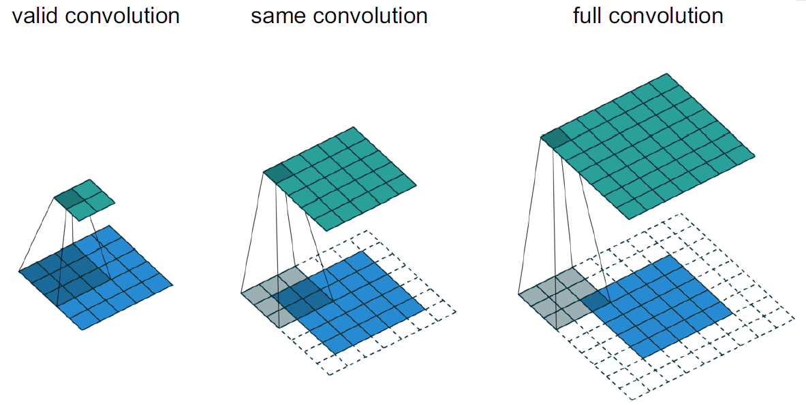
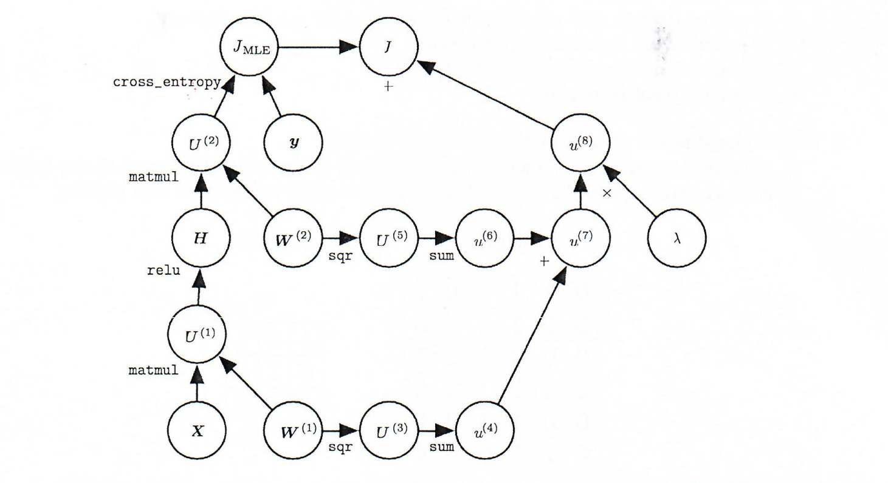
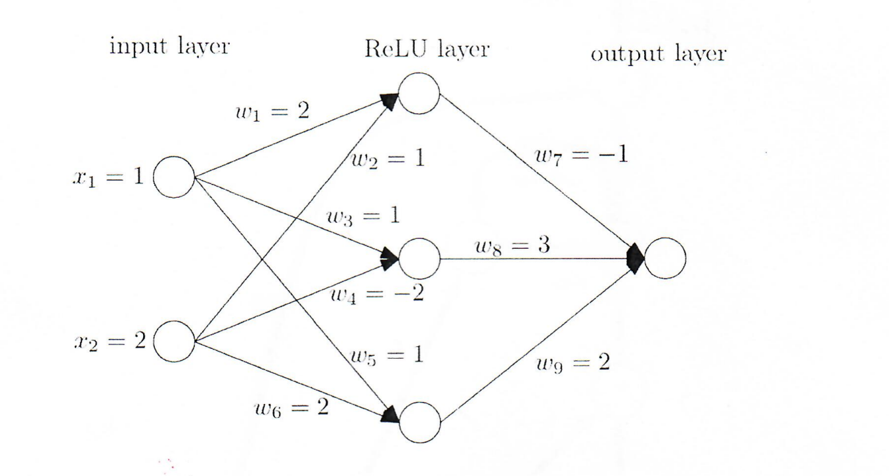
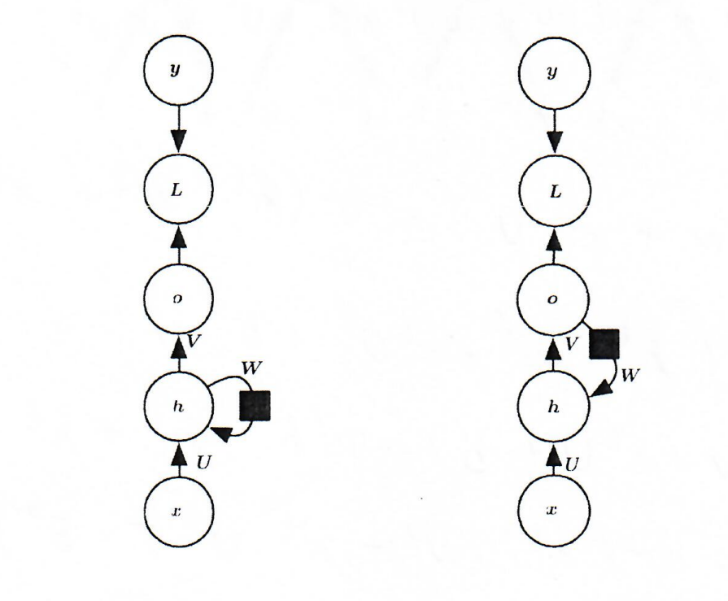
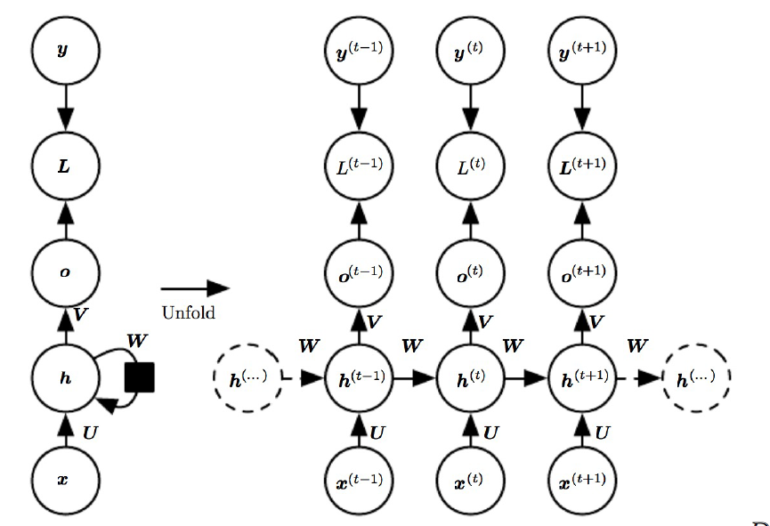
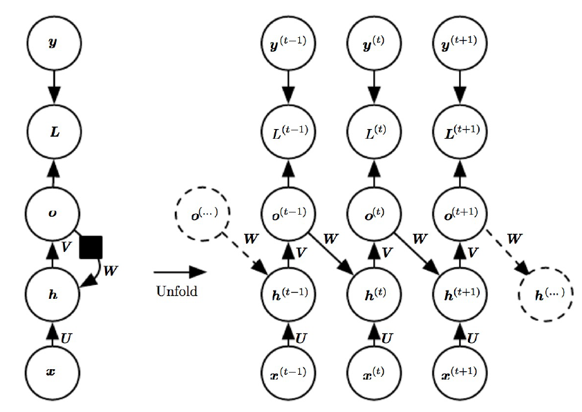
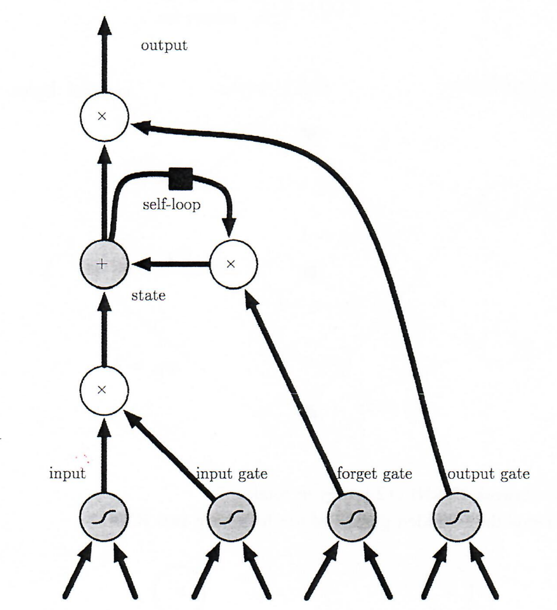

# Deep Learning Midterm Exam (Fall 2021) — 題目與解答

> 規則:每題答案限 3 句話、閉書、不可使用手機/計算機/筆電。據說要用全英文作答。

## 目錄

1. [Neural network architecture (20 pts)](#1-neural-network-architecture-20-points)
2. [Regularization (16 pts)](#2-regularization-16-points)
3. [Convolutional neural network (16 pts)](#3-convolutional-neural-network-cnn-16-points)
4. [Network training (36 pts)](#4-network-training-36-points)
5. [Recurrent neural network (12 pts)](#5-recurrent-neural-network-rnn-12-points)
6. [共筆末尾備忘題](#6-共筆末尾備忘題)

---

## 1) Neural network architecture (20 points)

### 1a) (4 pts) Under what conditions sigmoid units would be preferred for output and under what conditions softmax units would be preferred instead?

**Answer:**
Sigmoid is preferred for binary classification or independent probabilities (e.g. multi-label). Softmax is preferred for multiclass classification with mutually exclusive classes, since the outputs sum to 1.

- Sigmoid: `σ(z) = 1 / (1 + e^(-z))`, squashes (−∞, ∞) into (0, 1), interpretable as the probability of the positive class.
- Softmax: `s(x_i) = exp(x_i) / Σ_j exp(x_j)`, outputs sum to 1, so each instance belongs to exactly one class.

### 1b) (4 pts) Why are rectified linear units (ReLU) a preferred choice of activation functions for hidden units?

**Answer:**
- Non-linearity
- Computational efficiency
- Avoids the vanishing gradient problem (gradient is 1 for x > 0)
- Sparse activations
- Model expressiveness

### 1c) (4 pts) Explain the purpose of skip connections.

**Answer:**
Skip connections preserve information and gradients that would otherwise be lost or diluted when passing through many layers. They also combine features from different levels of abstraction and resolution, which enhances the representation power of the network.

### 1d) (4 pts) What does the "universal approximation theorem" state for neural networks?

**Answer:**
A feedforward network with a linear output layer and at least one hidden layer with any "squashing" activation function (e.g. logistic sigmoid) can approximate any Borel measurable function from one finite-dimensional space to another with any desired nonzero error, provided the network has enough hidden units.

### 1e) (4 pts) What is the similarity and what is the difference in ideas between CNNs and RNNs?

**Answer:**

- **Difference:** CNNs are designed for spatial / grid-like data (images) and use convolution to extract local features. RNNs are designed for sequential data (text, time series) and maintain memory across time steps through recurrent connections.
- **Similarity:** Both use parameter sharing (shared filters in CNNs, shared weights across time steps in RNNs) and both automatically learn hierarchical representations.

---

## 2) Regularization (16 points)

### 2a) (4 pts) Explain why regularization is required for machine learning.

**Answer:**
Regularization prevents overfitting, where a model becomes too specific to the training data and generalizes poorly to unseen data. It adds a penalty term (e.g. L1, L2) to the loss function, encouraging simpler models and better generalization.

### 2b) (4 pts) What is dataset augmentation?

**Answer:**
Dataset augmentation artificially expands the training set by applying transformations (rotation, scaling, flipping, etc.) to existing data. This provides more diverse examples and improves generalization.

### 2c) (4 pts) How does early stopping work?

**Answer:**
Monitor the model's performance on a validation set during training, and halt training when validation performance starts to deteriorate. This indicates overfitting, so stopping prevents the model from learning noise in the training data.

### 2d) (4 pts) What is dropout?

**Answer:**
Dropout randomly sets a fraction of units to zero at each training update. It introduces noise and discourages complex co-adaptations of neurons. It acts like an ensemble of many sub-networks, making the model more robust.

---

## 3) Convolutional neural network (CNN) (16 points)

### 3a) (4 pts) Calculate the output of the CNN given the input and the kernel shown below. Use cross-correlation, no stride, no zero padding.

Input (6×6):

```
0 1 1 1 0 0
0 0 1 1 1 0
0 0 0 1 1 1
0 0 0 1 1 0
0 0 1 1 0 0
0 1 1 0 0 0
```

Kernel (3×3):

```
1 0 1
0 1 0
1 0 1
```

**Answer:** output size is 4×4.

```
1 4 3 4
1 2 4 3
1 2 3 4
1 3 3 1
```

### 3b) (4 pts) Convolution leverages three important ideas that can help improve a machine learning system. What are they? Briefly explain each.

**Answer:**
1. **Sparse interactions:** each output unit is connected only to a local region of the input, so fewer parameters are stored. This reduces memory and improves statistical efficiency.
2. **Parameter sharing:** the same parameters are used at multiple locations. Convolution is therefore far more efficient than dense matrix multiplication in memory and statistical efficiency.
3. **Equivariant representations:** if the input changes (e.g. shifts), the output changes in the same way. This makes the network robust to transformations of the input and helps generalization.

### 3c) (4 pts) What is the advantage of using pooling?

**Answer:**
Pooling replaces the output at a location with a summary statistic of nearby outputs. It makes the representation approximately invariant to small translations of the input (most pooled outputs do not change when the input is translated slightly), and it reduces the representation size.

### 3d) (4 pts) Explain why zero padding is needed in CNNs. Draw and describe valid convolution, same convolution, and full convolution.

**Answer:**
Zero padding lets us control the kernel width and the output size independently. Without it, we must choose between shrinking the spatial extent of the network rapidly and using small kernels.

- **Valid convolution:** no padding; the output is smaller than the input.
- **Same convolution:** zero padding keeps the output the same size as the input.
- **Full convolution:** the filter and input overlap at every possible position (padding of kernel size − 1); the output is larger than the input.

<p align="center">
  
  <br>
</p>

(Drawing: the standard valid / same / full convolution figure, with the blue input, dashed padding, and green output grid.)

---

## 4) Network training (36 points)

### 4a) (4 pts) What is wrong with the description "Back-propagation refers to the method for exhaustively computing the gradient and performing learning using this gradient."?

**Answer:**
Back-propagation refers only to the method for computing the gradient (efficiently, by reusing intermediate results, not "exhaustively"). It does not perform learning. Learning is done by another algorithm, such as (stochastic) gradient descent, which uses the gradient.

### 4b) (8 pts) Fill out the blanks (circled numbers) in the paragraph about the computational graph.

The cost is `J = J_MLE + λ(Σ (W⁽¹⁾_ij)² + Σ (W⁽²⁾_ij)²)`, and the graph is `X → matmul(W⁽¹⁾) → U⁽¹⁾ → relu → H → matmul(W⁽²⁾) → U⁽²⁾ → cross_entropy(y) → J_MLE`, plus the weight-decay branch. All answers must be a matrix, vector, or scalar.

<p align="center">
  
  <br>
</p>

**Answer:**

| Blank | Answer |
|---|---|
| ① (weight decay contribution to the gradient on W⁽ⁱ⁾) | `2λW⁽ⁱ⁾` |
| ② (added to the gradient on W⁽²⁾) | `HᵀG` |
| ③ (∇_H J) | `G W⁽²⁾ᵀ` |
| ④ (added to the gradient on W⁽¹⁾) | `XᵀG′` |

> 註:共筆把 ③ 寫成 `GW⁽²⁾`,漏了轉置。正確應為 `G W⁽²⁾ᵀ`,維度才對得起來。

### 4c) (4 pts) Explain the gradient descent algorithm and the stochastic gradient descent (SGD) algorithm.

**Answer:**
- **Gradient descent:** uses the gradient from back-propagation to learn. Since `f(x − ε·sign(f′(x))) < f(x)` for small enough ε, we reduce f by moving x in small steps against the sign of the derivative.
- **SGD:** an extension of gradient descent. The gradient is an expectation, so it can be approximately estimated from a small set of samples (a minibatch), which makes each update cheap.

### 4d) (4 pts) What are the ideas behind the momentum algorithm and the Nesterov momentum algorithm?

**Answer:**
- **Momentum:** accumulates an exponentially decaying moving average of past gradients and continues to move in their direction. This speeds up learning and damps oscillation.
- **Nesterov momentum:** the gradient is evaluated after the current velocity is applied. It can be interpreted as adding a correction factor to standard momentum.

### 4e) (4 pts) What are the advantages and disadvantages of first-order and second-order training algorithms?

**Answer:**

| | Advantages | Disadvantages |
|---|---|---|
| **First-order** | Computation- and memory-efficient; suitable for large-scale datasets | May converge slowly; sensitive to the learning rate |
| **Second-order** | Faster convergence thanks to curvature information; adaptive step sizes | Computationally complex; memory-intensive; potential numerical instability |

### 4f) (4 pts) Briefly explain the idea of the Adam algorithm.

**Answer:**
Adam ("adaptive moments") is an adaptive learning rate algorithm that combines RMSProp and momentum. It keeps exponentially weighted estimates of the first moment (mean) and second moment (uncentered variance) of the gradient, with bias correction, and uses them to give each parameter its own adaptive learning rate.

> 共筆原註:這題原作者自評寫得不好,此處已改寫。

### 4g) (8 pts) Compute all weights wᵢ after one SGD update (MSE cost, output is 3, learning rate 0.1).

Network: input `x₁ = 1, x₂ = 2`; three ReLU hidden units; one output unit.

<p align="center">
  
  <br>
</p>

| Weight | Initial value | Connection |
|---|---|---|
| w₁ | 2 | x₁ → h₁ |
| w₂ | 1 | x₂ → h₁ |
| w₃ | 1 | x₁ → h₂ |
| w₄ | −2 | x₂ → h₂ |
| w₅ | 1 | x₁ → h₃ |
| w₆ | 2 | x₂ → h₃ |
| w₇ | −1 | h₁ → output |
| w₈ | 3 | h₂ → output |
| w₉ | 2 | h₃ → output |

ReLU derivative: `f′(x) = 1 if x > 0, else 0`.

**Forward pass:**

- h₁ = 2·1 + 1·2 = 4
- h₂ = 1·1 + (−2)·2 = −3 → ReLU = 0 (dead unit)
- h₃ = 1·1 + 2·2 = 5
- ŷ = (−1)(4) + 3(0) + 2(5) = **6**

**Backward pass** (L = (ŷ − 3)², so dL/dŷ = 2(6 − 3) = 6):

| Weight | Gradient | New value (lr = 0.1) |
|---|---|---|
| w₁ | 6·w₇·x₁ = −6 | **2.6** |
| w₂ | 6·w₇·x₂ = −12 | **2.2** |
| w₃ | 0 | **1** |
| w₄ | 0 | **−2** |
| w₅ | 6·w₉·x₁ = 12 | **−0.2** |
| w₆ | 6·w₉·x₂ = 24 | **−0.4** |
| w₇ | 6·h₁ = 24 | **−3.4** |
| w₈ | 6·h₂ = 0 | **3** |
| w₉ | 6·h₃ = 30 | **−1** |

> 註:共筆把 w₂ 寫成 −0.2(旁邊有人留言「我算 2.2」),正確應為 **2.2**。

---

## 5) Recurrent neural network (RNN) (12 points)

### 5a) (4 pts) Draw the unfolded graphs of the following two RNNs.

<p align="center">
  
  <br>
</p>

Left RNN: recurrence from `h` to `h` (weight W). Right RNN: recurrence from the output `o` to `h` (weight W). Both have `x → h` (U), `h → o` (V), and `o, y → L`.

**Answer:**

- **Hidden-to-hidden recurrence (left):** for each time step t−1, t, t+1: `x⁽ᵗ⁾ →U→ h⁽ᵗ⁾ →V→ o⁽ᵗ⁾ → L⁽ᵗ⁾ ← y⁽ᵗ⁾`, and the hidden states are chained by `h⁽ᵗ⁻¹⁾ →W→ h⁽ᵗ⁾ →W→ h⁽ᵗ⁺¹⁾`.
- **Output-to-hidden recurrence (right):** same per-step structure, but the recurrent edge goes from the previous output: `o⁽ᵗ⁻¹⁾ →W→ h⁽ᵗ⁾ `, `o⁽ᵗ⁾ →W→ h⁽ᵗ⁺¹⁾`.

In both graphs U, V, W are shared across all time steps.

<p align="center">
  
  <br>
</p>

### 5b) (8 pts) Derive the mathematical expression for both the internal state s⁽ᵗ⁾ and the current hidden layer h⁽ᵗ⁾ of the LSTM cell.

<p align="center">
  
  <br>
</p>

Notation: forget gate (bᶠ, Uᶠ, Wᶠ), input gate (bᵍ, Uᵍ, Wᵍ), output gate (bᵒ, Uᵒ, Wᵒ), cell input (b, U, W); activation σ(·); all variables are scalars.

**Answer:**

```
f(t) = σ( bᶠ + Uᶠ·x(t) + Wᶠ·h(t-1) )          # forget gate
g(t) = σ( bᵍ + Uᵍ·x(t) + Wᵍ·h(t-1) )          # input gate
q(t) = σ( bᵒ + Uᵒ·x(t) + Wᵒ·h(t-1) )          # output gate

s(t) = f(t)·s(t-1) + g(t)·σ( b + U·x(t) + W·h(t-1) )     # internal state
h(t) = tanh( s(t) ) · q(t)                                # hidden state
```

<p align="center">
  
  <br>
</p>

> 註:標準 LSTM 的 cell input 通常使用 tanh,但題目指定 activation function 為 σ(·),所以這裡照題目用 σ。`h(t)` 的 `tanh(s(t))` 為標準形式。

---

## 6) 共筆末尾備忘題

共筆最後列了三個可能考的題目,但沒有寫解答。以下為簡短補充(非共筆原內容):

- **Difference between optimization problem & machine learning problem:** Pure optimization minimizes a cost function directly on the given objective. Machine learning minimizes a surrogate loss on the training set but actually cares about performance on unseen data (generalization), which is why regularization and early stopping are needed.
- **Why use SGD but not GD:** Full-batch GD needs the whole dataset for every update, which is too expensive for large datasets. The gradient is an expectation that a minibatch can estimate well, so SGD makes many cheap updates and converges faster in wall-clock time.
- **Shuffle data:** Shuffling each epoch keeps minibatches approximately i.i.d. samples of the dataset, so the minibatch gradient stays an unbiased estimate of the full gradient, and it avoids bias from the data ordering.
