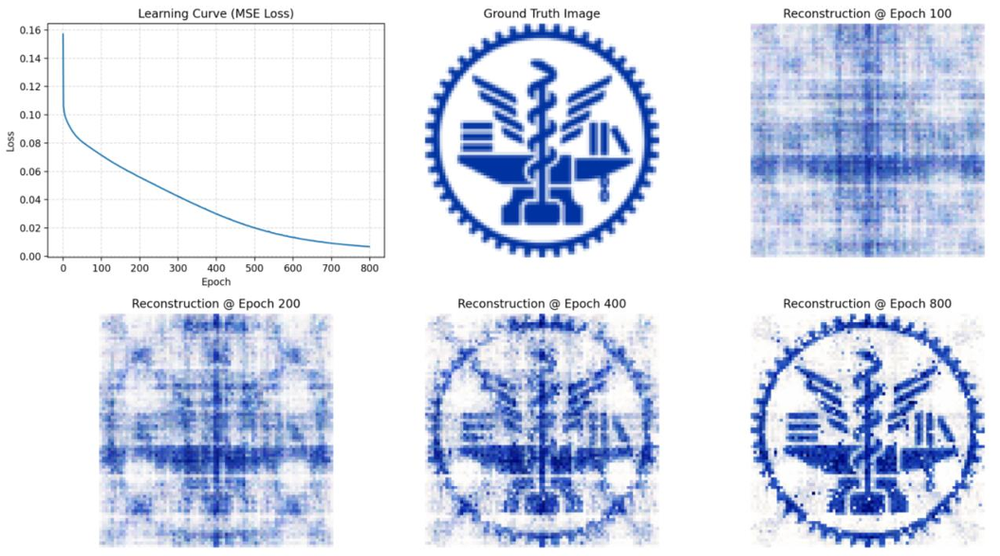
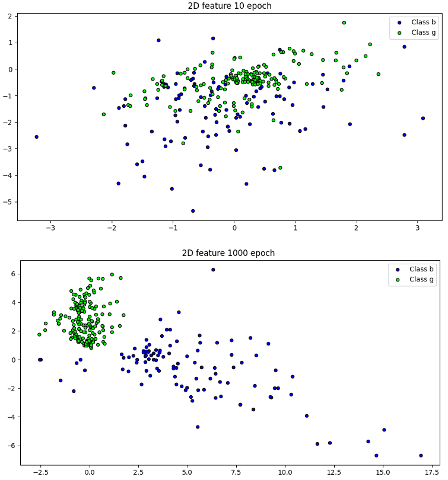

build a deep neural network model by using the backpropagation and stochastic gradient descent algorithm. You may design the network architecture by yourself, including the number of hidden layers, the number of hidden units, learning rate, the number of epochs and mini-batch size. Do not use available machine learning or deep learning packages. It means that you cannot use function like ”tf.nn.dense”, ”tf.nn.sigmoid cross entropy with logits” which have been already written.

# Q1 Regression

In this problem, you are asked to implement a neural network to learn an implicit neural representation (INR) of an image. Instead of predicting tabular features, the network will act as a continuous function $f_w(x, y) \rightarrow (r ,g ,b)$  that maps 2D spatial coordinates $(x, y)$ to RGB color values. 

Dataset & preprocessing: 

You will be provided with an image file (e.g., target.png, recommended size: 80 × 80 to 100 × 100 pixels). 
1. Normalize the coordinate grid $(x, y)$ such that both $x, y \in [-1, 1]$. 
2. Normalize the RGB ground-truth values to [0, 1]. 
3. Flatten all coordinates and colors into samples of shape $(N, 2) and (N, 3)$, where $N = H \times W$. 
4. Shuffle and split the pixels: use **90%** of the pixels for **training** and **10%** for **testing** (evaluating the model's ability to interpolate unseen pixels).

## (a) Objective function & metric:

Train your neural network by minimizing the sum-of-squares error (SSE) or mean-squared-error (MSE) function.

$$
E(\mathbf{w}) = \sum_{n=1}^{N} \parallel\mathbf{t}_n - \mathbf{y}(\mathbf{x}_n; \mathbf{w}) \parallel^2 = \sum_{n=1}^{N} \sum_{c \in \{R,G,B\}} (t_{nc} - y_c(\mathbf{x}_n; \mathbf{w}))^2
$$

Evaluate the reconstruction performance on both training and test sets using root-mean-square Error (RMS).

$$
E_{\text{RMS}}(\mathbf{w}) = \sqrt{\frac{1}{3N} \sum_{n=1}^{N} \sum_{c \in \{R,G,B\}} (t_{nc} - y_c(\mathbf{x}_n; \mathbf{w}))^2}
$$

## (b)

Show your (1) network architecture (number of hidden layers and neurons), (2) learning curve, (3) training RMS error, (4) test RMS error, (5) original ground truth image and (6) reconstructed images generated by feeding all $(x, y)$ coordinates into the trained network at different stages (e.g., Epoch 100, Epoch 200, Epoch 400, and Final Epoch). 

## (c)

Standard MLPs taking raw $(x, y)$ as inputs often suffer from spectral bias (producing blurry images). Compare the reconstruction results between using raw coordinates versus encoded coordinates (e.g., Fourier feature mapping or periodic functions), and explain why encoding recovers fine details. 

  

# Q2 Classification

Implement the neural network for binary classification by using the Ionosphere dataset. There are 34 different features and 2 classes. The last column represents their corresponding labels:“g” for good and “b” for bad. Use 80% of data samples for training and 20% for testing.

## (a)

Please try to classify the Ionosphere data by minimizing the cross-entropy error function.

$$
E(\mathbf{w}) = -\sum_{n=1}^{N} \sum_{k=1}^{K} t_{nk} \log_{y_k}(\mathbf{x}_n, \mathbf{w})
$$

## (b)

Show your (1) network architecture (number of hidden layers and neurons), (2) learning curve, (3) training error rate, (4) test error rate in the report.

## (c)

Compare the results of choosing different numbers of nodes in the layer before the output layer by plotting the distribution of latent features at different training stage. 

  

