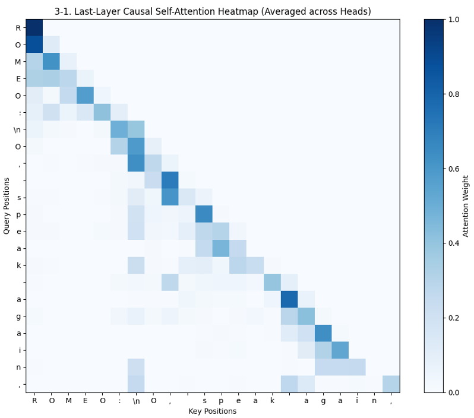

- You are allowed to use **high-level** APIs, such as PyTorch, TensorFlow / Keras, etc.

# 1. Dataset & tokenization

In this homework, you will train autoregressive language models on the provided Shakespeare dataset (`shakespeare_train.txt` and `shakespeare_valid.txt`).

## 1-1. Character-level vs. subword (BPE) tokenization

- Character-level: Build a character vocabulary from the dataset (vocab size ≈ 65 ~ 80).
- Subword-level: Train or load a byte-pair encoding (BPE) tokenizer with a small vocabulary size (e.g., 1000 ~ 2000) using libraries such as `tiktoken` or Hugging Face `tokenizers`.
- Deliverables:

  (1). Report the vocabulary size and the total number of tokens for both tokenizers on `shakespeare_train.txt`.
  
  (2). Calculate the sequence compression ratio:
   $$\text{Compression Ratio} = \frac{\text{Number of Characters}}{\text{Number of BPE Tokens}}$$
  
  (3). Briefly discuss the trade-offs between character-level and subword-level tokenization.

# 2. Language modeling: LSTM vs. causal Transformer

Train autoregressive language models to predict the next token given preceding context by minimizing the cross-entropy loss (or bits-per-character / perplexity):

$$\mathcal{L}(\mathbf{w}) = -\frac{1}{T}\sum_{t=1}^{T} \log P(x_t \mid x_1, \ldots, x_{t-1}; \mathbf{w})$$

For Section 2 and Section 3, please train both models using **character-level tokens** (or subword tokens).

## 2-1. LSTM language model

- Implement an LSTM language model (token embedding → LSTM layer(s) → linear projection).
- Deliverables:

  (1). Describe your network architecture (embedding dimension, hidden state size, number of layers, dropout rate, and optimizer).
  
  (2). Plot the **learning curves** (Training and Validation Loss vs. Epoch).
  
  (3). Select **5 breakpoints / epochs** during training, feed an initial seed character/word, and display the generated text to demonstrate how the model progressively learns language structure.

## 2-2. Causal Transformer decoder (mini-GPT)

- Implement a lightweight decoder-only Transformer (Token Embedding + Positional Encoding → Causal Self-Attention Blocks → Linear output). Make sure causal masking is applied so positions cannot attend to subsequent tokens.

- Deliverables:

  (1). Describe your Transformer architecture (embedding dimension, number of attention heads, feed-forward dimension, and number of layers).
  
  (2). Plot the **learning curves** (Training and Validation Loss vs. Epoch).
  
  (3). Provide a summary table comparing **LSTM** vs. **Transformer** in terms of: (i) parameter count, (ii) training time per epoch, and (iii) final validation loss. Discuss your observations.

# 3. Interpretability & controllable generation

## 3-1. Self-attention map visualization

- Extract the attention weights from the last multi-head self-attention layer of your trained Transformer for a prompt sequence (e.g., length 15 ~ 25 tokens).
- Plot the **2D attention heatmap** (Query positions vs. Key positions) averaged across heads (or display individual heads).

  
   
  <em>Figure 1: Example of last-layer causal self-attention heatmap (Query vs. Key tokens) </em>

- Discuss:

  (1). Explain the causal mask pattern (lower-triangular structure).
  
  (2). Observe whether certain tokens (e.g., punctuation marks, character names, or newline tokens) exhibit specific attention patterns.

## 3-2. Prompting & temperature-controlled sampling

- Prime your models with a prompt related to the dataset (e.g., `"ROMEO: "` or `"JULIET: "`) and generate 10 ~ 15 lines of text.
- Implement temperature-scaled sampling for next-token probabilities:

  $$P(x_t = i) = \frac{\exp(z_i / T)}{\sum_j \exp(z_j / T)}$$

- Compare the text generated under different temperatures:

  (a). Low temperature ($T = 0.2$)
  
  (b). Medium temperature ($T = 0.8$)
  
  (c). High temperature ($T = 1.5$)
  
- Discuss the effect of temperature on randomness, creativity, and grammatical coherence.

---

# Recommended libraries

- **PyTorch** / **TensorFlow**
- `tiktoken` / `tokenizers` (Hugging Face)
- **Matplotlib** / **Seaborn** (for loss curves and attention heatmaps)
